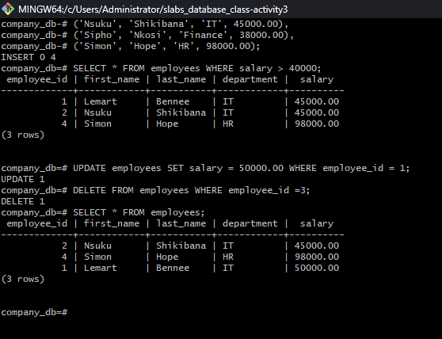

#Author Lemart Bennee

1. Vertical Vs. Horizontal Software
Vertical Package: a hospital management system example, patient admissions, billing, and medical records software. 
Horizontal package: Microsoft Word example, using word to create a document for the company of using microsoft word to do your school work. 
How the differ: 
vertical users target one industry or business type, while horizontal industries target more than one industries

2. Operating System Modes: Batch Vs. Real-Time Processing
Batch processing: Jobs with similar needs are collected and run together as a group, without user interaction while they run. Results may not be neede instantly and the work is usually scheduled fo off peak times
Where batch processing would be used: A company running payroll at a month end or a a bank processing the days cheque clearance and genrating statements overnight.

Real-time processing: Input is processed immediately and the system must respond within a strict linit. A deleayed response can cause failure or danager.
Where real-time processing would be used: Industrail control systems such as factory robot line or a power plants safety monitoring, air traffic control or an dATM authorisation check

## PostgreSQL CRUD Operations

Below is the screenshot showing my INSERT, SELECT, UPDATE, and DELETE commands:

